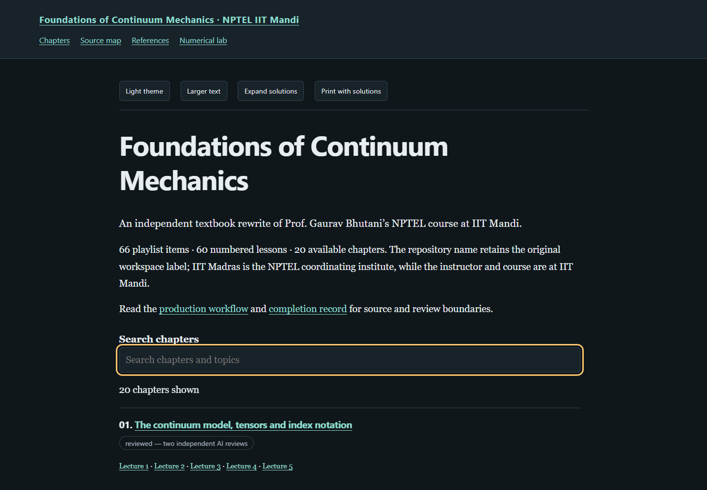

# Foundations of Continuum Mechanics — a textbook rewrite

**[Read the live textbook](https://az9713.github.io/nptel-continuum-mechanics-iitm-notes/)**

[](https://az9713.github.io/nptel-continuum-mechanics-iitm-notes/)

An independent study edition of Prof. Gaurav Bhutani’s NPTEL
[Foundations of Continuum Mechanics](https://nptel.ac.in/courses/112106912)
at **IIT Mandi**. IIT Madras coordinates the NPTEL course; the repository slug
retains the original workspace label.

The [YouTube playlist](https://www.youtube.com/playlist?list=PLyqSpQzTE6M8goni-cNmCqEp3jMFXLgdf)
provides the topic spine: **60 numbered lessons, two uploads of lesson 6,
an introductory trailer, and four live discussions — 66 recordings in all**.
The notes organize these into **20 chapters**, with **129 worked solutions**,
**20 executable Python examples**, and an interactive numerical laboratory.
Numbered lessons follow course order; live sessions have separate discussion
companions. The source map retains every item’s original playlist position.

The exposition develops definitions, derivations, assumptions, dimensional
checks, worked cases and approximation boundaries. Original constructions
are distinguished from lecture material and inspected external references.
Examples connect tensor transformations, traction, finite deformation,
transport laws, objective constitutive models, elasticity, viscoelasticity,
plasticity and viscous flow.

The reader includes searchable chapter navigation, bundled MathJax,
dark/light themes, adjustable text size, expandable solutions, code copying
and printing with solutions. Downloading the repository gives an offline
edition with no runtime CDN dependency.

Explore the [source map](https://az9713.github.io/nptel-continuum-mechanics-iitm-notes/source-map.html),
[references](https://az9713.github.io/nptel-continuum-mechanics-iitm-notes/references.html),
and [numerical lab](https://az9713.github.io/nptel-continuum-mechanics-iitm-notes/numerical-lab.html).

## Run locally

Open `index.html` in a browser. Python is needed only to rebuild or run checks.
The tested dependency versions are in [requirements.txt](requirements.txt).
Browser checks use installed Chrome, with bundled Playwright Chromium as a
fallback (`python -m playwright install chromium`).

```sh
python -m pip install -r requirements.txt
python tools/build_book.py
python tools/validate_books.py --browser
python tools/check_chapter_code.py
python numerical_lab.py
```

The builder uses the standard library. Code checks also use Beautiful Soup;
the examples and numerical lab require NumPy. The builder preserves exact
chapter-body bytes and refuses a digest mismatch. A deliberate content edit
requires scientific review and an explicitly revised body guard before rebuilding.

## Sources, review and evidence

All 66 recordings were acquired and their decoded audio durations checked
against the playlist. Caption requests failed, so full local machine ASR
(`faster-whisper small.en`) supplied the working transcripts. Authors read
their assigned transcripts in sequence. ASR can misrecognize terminology and
cannot recover every board equation or silently displayed numerical input.
Uncertain inputs are qualified locally; original numerical cases are labelled.
No comprehensive audiovisual transcription is claimed.

Separate AI scientific reviewers inspect the manuscripts, derivations, solutions,
targeted source evidence and executable examples. Review acceptance binds
exact authored-body hashes. A scientific rewriter is treated as an author,
and does not independently accept the same chapter. The curated
[editorial record](editorial-review-summary.json) describes the actual outcome
and limits. Automated execution checks mathematical implementation; it does
not establish experimental validity or general correctness.

All 20 chapters passed two separate AI reviews. All 20 Python listings passed
isolated execution and matched their displayed output. A public-only export
rebuilt all 25 HTML pages byte for byte, then passed the code, numerical-lab,
static-link and 48 offline page/viewport checks. The lab also passed 48
independently calculated JavaScript states. These checks retain the source
and review limitations above.

The [workflow](WORKFLOW.md), [source record](source-validation-summary.json),
[content inventory](content-inventory.json), [code checks](chapter-code-validation.json),
[reader checks](reader-validation.json), [package checks](package-validation.json),
[source-free rebuild](source-free-validation.json),
[publication check](publication-validation.json), and
[completion record](completion.json) retain reproducible evidence and scope.
Raw recordings, ASR text, acquisition tools and logs, downloaded reference
materials, and private editorial reports remain in ignored `work/`.

Reader styling and the root-HTML/sidecar/evidence arrangement follow the
[NPTEL Fluid Mechanics project](https://github.com/az9713/nptel-fluid-mechanics-kanpur-notes),
with review and release practices informed by the other NPTEL and Stanford
lecture-note repositories. MathJax’s bundled license is retained in `assets/`.
